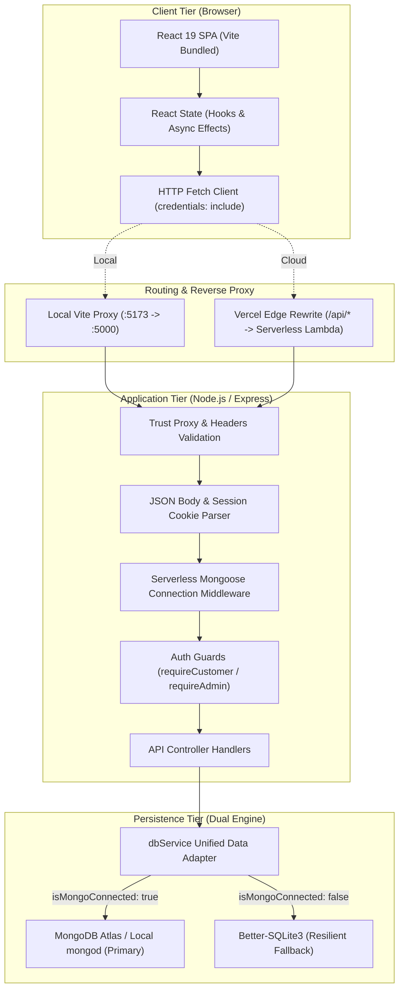
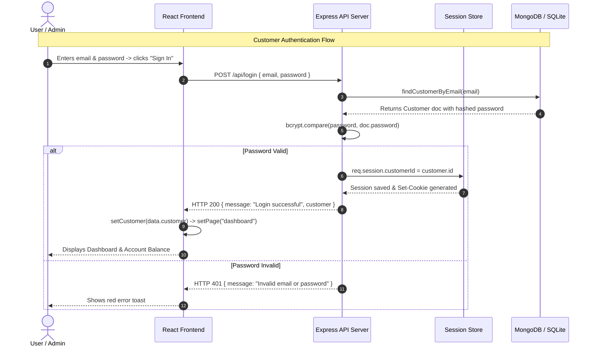
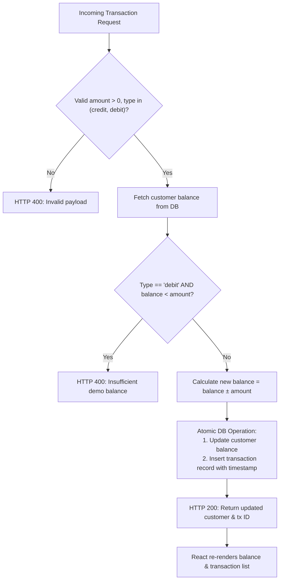
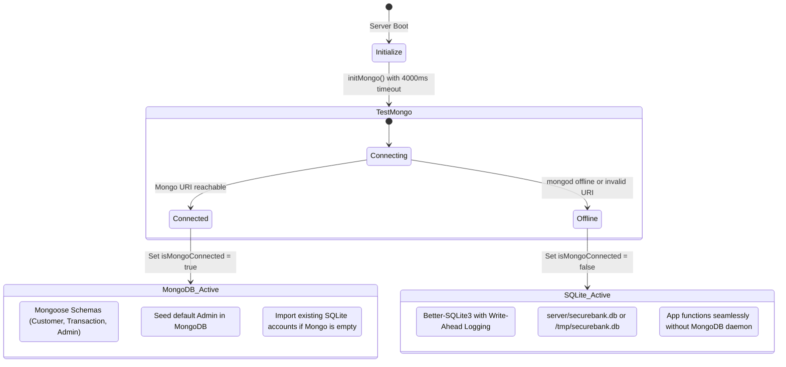
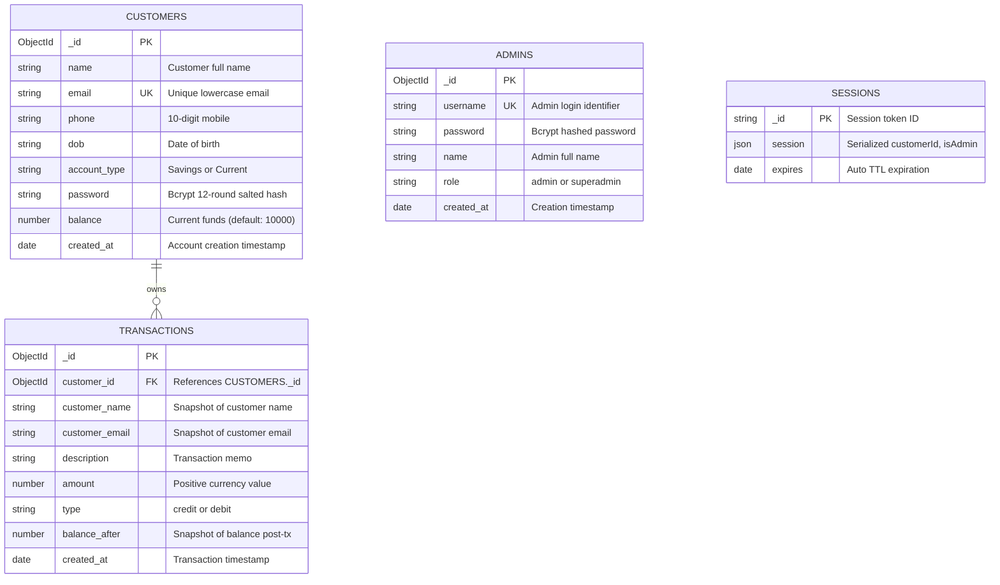
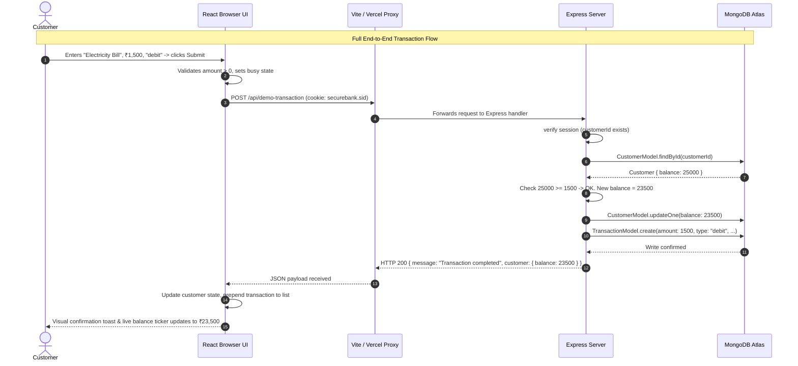

# SecureBank — End-to-End System Architecture & Workflow Guide

An in-depth, end-to-end technical breakdown of the **SecureBank** application: from the moment a user clicks in the browser, through frontend event cycles, network transit, API middleware, cryptographic authentication, business logic, dual-engine database transactions (MongoDB & SQLite), to response dispatch and DOM re-rendering.

---

## Table of Contents
1. [High-Level Architectural Overview](#1-high-level-architectural-overview)
2. [Technology Stack Matrix](#2-technology-stack-matrix)
3. [The End-to-End Request/Response Lifecycle](#3-the-end-to-end-requestresponse-lifecycle)
4. [Detailed Workflow Deep Dives](#4-detailed-workflow-deep-dives)
   - [A. Customer Registration & Cryptographic Hashing](#a-customer-registration--cryptographic-hashing)
   - [B. Customer Authentication & Session Management](#b-customer-authentication--session-management)
   - [C. Simulated Financial Transactions (Double-Entry Ledger)](#c-simulated-financial-transactions-double-entry-ledger)
   - [D. Admin Control Plane & Balance Adjustments](#d-admin-control-plane--balance-adjustments)
   - [E. Hybrid Database Engine & Automatic Fallback](#e-hybrid-database-engine--automatic-fallback)
5. [Data Models & Schema Architecture](#5-data-models--schema-architecture)
6. [Security Architecture & Guardrails](#6-security-architecture--guardrails)
7. [Vercel Serverless Deployment Architecture](#7-vercel-serverless-deployment-architecture)
8. [Summary Sequence Diagram](#8-summary-sequence-diagram)

---

## 1. High-Level Architectural Overview

SecureBank is structured as a decoupled full-stack web application designed for both local high-performance execution and cloud serverless deployment:



---

## 2. Technology Stack Matrix

| Tier | Technology | Purpose |
| :--- | :--- | :--- |
| **Frontend Framework** | React 19 + Vite 8 | Declarative component tree, fast-refresh HMR, optimized static chunk bundling. |
| **UI Design System** | Vanilla CSS (Aceternity Studio inspired) | Dashed blueprint grids, glassmorphic pill navbar, bento grid, responsive layout. |
| **Typography & Icons** | Plus Jakarta Sans + Lucide React | High-contrast geometric typography and scalable SVG icons. |
| **Backend Framework** | Node.js (v24) + Express 5 | High-throughput asynchronous REST API routing and middleware pipeline. |
| **Authentication & Crypto** | `bcryptjs` (12 rounds) + `express-session` | Cryptographic salt-hashed password security; `httpOnly` secure session cookies. |
| **Session Persistence** | `connect-mongo` + MemoryStore | Session storage across serverless lambda containers in MongoDB `sessions` collection. |
| **Primary Database** | MongoDB (Mongoose v9 ODM) | Document persistence, strict Schema types, scalable cloud Atlas clustering. |
| **Fallback Database** | `better-sqlite3` | Local high-speed C++ embedded SQLite database with Write-Ahead Logging (WAL). |
| **Deployment Platform** | Vercel Serverless Functions | Serverless deployment via `api/index.js` and `vercel.json` rewrites. |

---

## 3. The End-to-End Request/Response Lifecycle

Every action performed on SecureBank travels through seven distinct stages. Here is the step-by-step path of a single query:

### Stage 1: User Event Trigger in the Browser
1. The user interacts with the UI (e.g., clicks **"Submit Demo Transaction"** or **"Sign In"**).
2. React's synthetic event handler (`onSubmit` / `onClick`) intercepts the action.
3. Form states (e.g., `payment.amount`, `payment.description`, `payment.type`) are extracted from local React state.
4. **Client-side sanity checks** run immediately (e.g., ensuring the amount is greater than zero, fields are non-empty).

### Stage 2: Network Client Dispatch (`api()` Helper)
The internal HTTP utility function in `client/src/main.jsx` dispatches the request:
```javascript
async function api(url, options = {}) {
  const response = await fetch(url, {
    credentials: "include", // Transmits securebank.sid cookie
    headers: {
      "Content-Type": "application/json",
      ...options.headers
    },
    ...options
  });
  ...
}
```
* **Why `credentials: "include"` matters:** Browsers do not send session cookies across origins or ports by default. This directive forces the browser to attach the `securebank.sid` cookie with every request.

### Stage 3: Reverse Proxy & Network Routing
* **In Local Development:** Vite dev server runs on `http://127.0.0.1:5173`. When a request hits `/api/demo-transaction`, Vite's proxy rule in `vite.config.js` transparently forwards the traffic to Express at `http://127.0.0.1:5000/api/demo-transaction`.
* **In Production (Vercel):** Requests to `/api/(.*)` match `vercel.json` rewrites and invoke the serverless function handler at `/api/index.js`.

### Stage 4: Express Middleware Chain
Once the request reaches Express, it flows through a sequential pipeline:
1. `app.set("trust proxy", 1)`: Tells Express to trust Vercel's front-facing HTTPS proxy, allowing correct detection of HTTPS and client IPs.
2. `express.json()`: Streams incoming request chunks, parses the raw JSON payload, and attaches it to `req.body`.
3. `session(sessionOptions)`: 
   - Reads the signed cookie `securebank.sid`.
   - Fetches the active session record from the session store (MongoDB `sessions` collection or memory).
   - Populates `req.session` with `customerId`, `isAdmin`, etc.
4. **Serverless MongoDB Warm-Up Middleware:**
   ```javascript
   app.use(async (req, res, next) => {
     try { await initMongo(); } catch {}
     next();
   });
   ```
   Ensures that on serverless cold starts, the Mongoose connection is verified before running the controller.

### Stage 5: Route Controller & Authorization Guards
The request matches the specific route (e.g., `app.post("/api/demo-transaction", requireCustomer, ...)`).
* `requireCustomer` verifies `req.session.customerId`. If not found, it immediately halts execution and returns HTTP `401 Unauthorized`.
* Business rules execute:
  - Input type and range validation.
  - Verification that the customer exists.
  - Balance sufficiency check for debits (`customer.balance >= value`).

### Stage 6: Database Execution via `dbService`
The controller delegates persistence to the unified abstraction layer `dbService`:
* If MongoDB is online:
  - Performs `CustomerModel.findByIdAndUpdate(customerId, { balance: newBalance })`.
  - Executes `TransactionModel.create({ customer_id, amount, type, description, balance_after })`.
* If MongoDB is offline:
  - Executes an atomic SQLite transaction via `sqliteDb.transaction(...)`, updating the `customers` table and inserting into `transactions`.

### Stage 7: Response & React DOM Reconciliation
1. Express sends an HTTP `200 OK` response with JSON body containing `{ message, customer }`.
2. The client `api()` function resolves the promise.
3. React executes state setters:
   - `setCustomer(result.customer)` updates the balance card.
   - `setTransactions(...)` updates the activity ledger.
   - `notify(...)` displays a temporary success toast notification.
4. React's Virtual DOM compares the previous component tree with the new state and surgically updates only the affected DOM nodes in milliseconds.

---

## 4. Detailed Workflow Deep Dives



---

### A. Customer Registration & Cryptographic Hashing
* **Endpoint:** `POST /api/signup`
* **Workflow:**
  1. Frontend gathers: `name`, `email`, `phone`, `dob`, `accountType`, `password`.
  2. Frontend ensures the password contains $\ge 8$ characters and the phone has exactly 10 digits.
  3. Server performs rigorous server-side regex validation:
     - Email syntax: `/^[^\s@]+@[^\s@]+\.[^\s@]+$/`
     - Phone: `/^\d{10}$/`
     - DOB: Checks valid ISO date $\le \text{today}$.
  4. Server checks database uniqueness: `dbService.findCustomerByEmail(email)`. If exists $\to$ HTTP `409 Conflict`.
  5. Password is processed using `bcrypt.hash(password, 12)`:
     - 12 salt rounds generate $2^{12} = 4096$ hashing iterations with cryptographically secure pseudo-random salt.
     - The plaintext password is never stored or logged anywhere.
  6. Account is created with an initial demo balance of **₹10,000**.
  7. Client receives confirmation and automatically navigates the user to the login screen with their email pre-filled.

---

### B. Customer Authentication & Session Management
* **Endpoint:** `POST /api/login`
* **Session Configuration:**
  - Cookie name: `securebank.sid`
  - `httpOnly: true`: JavaScript running in the browser cannot access `document.cookie`, preventing XSS token theft.
  - `sameSite: "lax"` (local) or `"none"` (cross-origin cloud): Protects against Cross-Site Request Forgery (CSRF).
  - `secure: true` on production HTTPS: Cookies are only transmitted over TLS-encrypted channels.
  - Expiration: 24 hours (`86,400,000 ms`).
* **Session Lifecycle:**
  - Upon successful `bcrypt.compare`, `req.session.regenerate()` creates a fresh session ID, mitigating session fixation attacks.
  - When the user logs out (`POST /api/logout`), `req.session.destroy()` flushes the session from memory/database and `res.clearCookie("securebank.sid")` clears the client browser cookie.

---

### C. Simulated Financial Transactions (Double-Entry Ledger)
* **Endpoint:** `POST /api/demo-transaction`
* **Guard:** `requireCustomer`



* **Atomic Ledger Integrity:**
  - A transaction record is never created without updating the customer's balance.
  - Conversely, a balance is never adjusted without recording a companion transaction document.
  - In MongoDB, documents are updated atomically; in SQLite, operations are wrapped in `sqliteDb.transaction(() => { ... })()`.

---

### D. Admin Control Plane & Balance Adjustments
* **Endpoints:**
  - `POST /api/admin/login`: Authenticates with `admin` / `admin123`. Sets `req.session.isAdmin = true`.
  - `GET /api/admin/stats`: Aggregates system metrics (total registered customers, total vault balance, transaction count, active database engine).
  - `GET /api/admin/customers`: Returns all customer records (sanitized, omitting password hashes).
  - `GET /api/admin/transactions`: Global audit stream of every transaction across all users.
  - `POST /api/admin/adjust-balance`: Direct administrative balance adjustment (deposit/credit or withdrawal/debit) with audit reason.
  - `DELETE /api/admin/customers/:id`: Administrative account termination and complete transaction ledger purge.

---

### E. Hybrid Database Engine & Automatic Fallback

SecureBank features an enterprise-grade database abstraction layer (`server/db.js`):



1. **MongoDB Mode (Primary):**
   - Connects to `process.env.MONGODB_URI`.
   - All reads and writes run through Mongoose models.
   - If connecting to an empty MongoDB database for the first time, it automatically reads existing local SQLite accounts and imports them into MongoDB collections.
2. **SQLite Fallback Mode:**
   - If MongoDB is unreachable (e.g., local developer has not installed or started `mongod` yet), the server catches the timeout error without crashing.
   - It seamlessly redirects database operations to `better-sqlite3`.
   - The user sees `Database: SQLite (Fallback mode)` on the frontend with instructions on how to connect Atlas.

---

## 5. Data Models & Schema Architecture



---

## 6. Security Architecture & Guardrails

1. **Password Protection:** Plaintext passwords never enter the persistence layer. Salts are generated using `bcryptjs` with cost factor 12.
2. **Session Security:**
   - Cookies are marked `httpOnly`, preventing client-side script inspection.
   - In production, cookies are marked `secure: true` (transmitted only over TLS).
   - Sessions regenerate on privilege elevation (`POST /api/login` and `POST /api/admin/login`).
3. **Role-Based Access Control (RBAC):**
   - Customer routes require valid `req.session.customerId`.
   - Admin routes require `req.session.isAdmin === true`. A normal customer cannot call `/api/admin/*` endpoints.
4. **Input Sanitization & Boundary Checking:**
   - Email normalization to lowercase.
   - Regex validation on phones and dates.
   - Positive numeric validation on currency values preventing negative numbers or `NaN` injection.
   - Maximum transaction cap (₹1,000,000 per demo transaction).

---

## 7. Vercel Serverless Deployment Architecture

When running on Vercel:
1. **Serverless Function Wrappers:**
   - Vercel does not run a permanent `node server/index.js` process.
   - The entry point [`api/index.js`](file:///C:/Users/athar/Downloads/SecureBank02/SecureBank02/api/index.js) imports and exports the Express `app`.
   - Vercel packages Express inside an AWS Lambda function triggered on demand.
2. **Reverse Proxy & Rewrite Rules:**
   - [`vercel.json`](file:///C:/Users/athar/Downloads/SecureBank02/SecureBank02/vercel.json) routes all `/api/*` requests to `/api/index.js`.
   - All other routes (`/*`) serve the pre-compiled Vite single-page application at `dist/index.html`.
3. **Connection Pooling in Serverless:**
   - In `server/db.js`, the MongoDB connection is cached in Node's `global.mongoose` object.
   - When AWS Lambda reuses a warm container, it reuses the existing MongoDB connection rather than creating a new connection on every request.
4. **Session Persistence in Serverless:**
   - Vercel serverless containers are stateless and ephemeral.
   - `connect-mongo` stores session records in MongoDB Atlas, meaning any Lambda instance across the globe can authenticate the user's session cookie.

---

## 8. Summary Sequence Diagram



